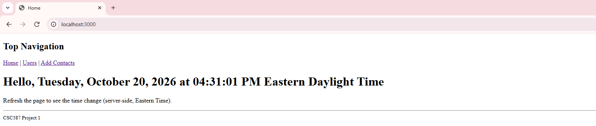

# Express MongoDB User Manager

A full-stack user management application built with Node.js, Express.js, EJS, and MongoDB. The application provides a web interface for managing user records, with persistent database storage and containerized deployment using Docker Compose.

## Features

- **Create:** Add new users through a web form.
- **Read:** View all users stored in MongoDB.
- **Update:** Edit existing user information.
- **Delete:** Remove user records.
- **Data Persistence:** Store user information in MongoDB so changes are retained after refreshing the page.
- **Containerization:** Run the application and database using Docker Compose.

## Tech Stack

| Technology | Purpose |
|---|---|
| Node.js | JavaScript runtime |
| Express.js | Backend web framework and routing |
| EJS | Server-side HTML templating |
| MongoDB | NoSQL database |
| Mongoose | MongoDB object modeling and database operations |
| Docker Compose | Container orchestration |

## Application Architecture

The application follows an MVC-inspired architecture that separates request handling, database operations, and presentation.

**Models:** Define user data and interact with MongoDB using Mongoose.

**Views:** Render dynamic pages using EJS templates.

**Controllers:** Process incoming requests, perform CRUD operations, and return the appropriate responses.

**Routes:** Map HTTP requests to controller functions.

### Request Flow

```text
Browser
   |
   v
Express Routes
   |
   v
Controllers
   |
   v
Mongoose Models
   |
   v
MongoDB Database
```

## Running the Application

### Prerequisites

- Git
- Docker Desktop with Docker Compose

### Installation

**1. Clone the repository**

```bash
git clone https://github.com/mclark-99/express-mongodb-user-manager.git
cd express-mongodb-user-manager
```

**2. Start the application**

```bash
docker compose up
```

Docker Compose starts the Node.js application and MongoDB database.

**3. Open the application**

Visit:

http://localhost:3000

**4. Stop the application**

Press `Ctrl+C` in the terminal, or run:

```bash
docker compose down
```

The MongoDB named volume preserves database records between container restarts.

## Application Preview



## Future Improvements

- Modern, responsive user interface
- Improved form validation and error handling
- Safer deletion workflow
- Automated testing
- Dependency security updates

## Project Background

Originally developed for CSC587: Modern Web Applications Using Server-Side Technologies at West Chester University.

The application was extended from an introductory Express project to include MongoDB integration, persistent storage, full CRUD operations, and Docker Compose deployment.

## Author

**Maiti Clark**  
M.S. Computer Science — West Chester University  
Expected Graduation: December 2026
